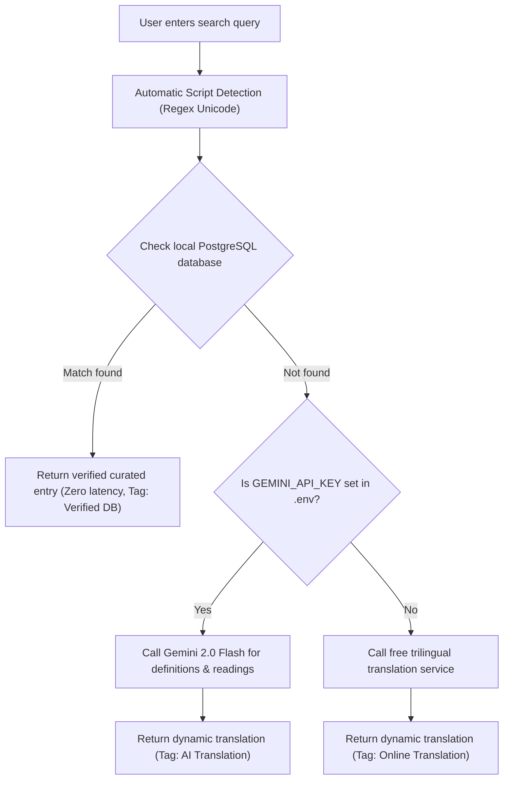

# LearnSolo: 3-Way Dictionary & Content Guide

A complete guide to using, managing, and writing content for LearnSolo's built-in **3-way dictionary** (English, Burmese, and Japanese).

---

## 1. Overview

The dictionary is a floating, resizable study companion available on every page of LearnSolo. It is designed specifically for students preparing for Japanese academic exams (such as the EJU and university entrance tests) who need fast, accurate translations across **English**, **Burmese (မြန်မာ)**, and **Japanese (日本語)**.

| Feature | Description |
|---|---|
| **Floating Action Button (FAB)** | Pinned to the bottom-right corner of the website. Available on all pages (Notes, Practice, Past Papers, Home). |
| **Interactive & Resizable** | Users can drag the top-left corner or edges to resize width and height, or click the maximize button to expand. Size is saved in `localStorage`. |
| **Automatic Language Detection** | Detects whether the user types in English, Burmese Unicode, or Japanese (Kanji/Kana) instantaneously without needing manual dropdown switches. |
| **Hybrid Lookup** | Queries your local curated PostgreSQL database first for instant zero-latency results. Falls back to AI/online translation if unlisted. |
| **Clean Database Policy** | Search queries do not clutter the database; only curated terms in `content/dictionary.json` or explicitly added via CLI are stored in PostgreSQL. |

---

## 2. Where Everything Lives

```text
learnsolo/
├── content/
│   └── dictionary.json               # The master vocabulary file (99+ curated terms)
├── docs/
│   ├── dictionary-guide.md           # This documentation guide
│   └── content-guide.md              # Main notes & practice sets guide
├── backend/
│   ├── app.py                        # Registers CLI commands: import-dictionary, list-dictionary, add-word
│   ├── models.py                     # DictionaryEntry SQLAlchemy database model
│   ├── migrations/versions/          # Database migration for dictionary_entries table
│   ├── api/dictionary.py             # GET /api/dictionary route
│   ├── services/dictionary.py        # Hybrid search, auto language detection, online fallback
│   └── tests/test_dictionary.py      # Automated pytest tests
└── frontend/
    └── src/
        ├── components/FloatingDictionary.jsx # Floating button, resizable modal & search logic
        └── styles/dictionary.css             # Drag handles, styling, Burmese font support
```

---

## 3. How to Manage Dictionary Content

LearnSolo follows a file-first philosophy: **your content lives in readable text files under `content/`**, and simple terminal commands import and manage it in PostgreSQL.

### Method 1: Bulk Editing via `content/dictionary.json` (Recommended)

To add many words at once or update definitions, open [content/dictionary.json](file:///home/music195/Projects/learnsolo/content/dictionary.json) in your code editor.

#### Entry Format

Each word is an object in the JSON array:

```json
{
  "word": "momentum",
  "english": "Momentum",
  "burmese": "အဟုန်",
  "japanese": "運動量",
  "reading": "うんどうりょう",
  "notes": "Physics: Product of mass and velocity (p = mv)"
}
```

#### Field Specifications:

| Field | Required? | Description | Example |
|---|---|---|---|
| `word` | **Yes** | Lowercase lookup key (used for database matching) | `"momentum"` |
| `english` | **Yes** | Display title and definition in English | `"Momentum"` |
| `burmese` | **Yes** | Burmese translation in standard Myanmar Unicode | `"အဟုန်"` |
| `japanese` | **Yes** | Japanese Kanji or Katakana term | `"運動量"` |
| `reading` | Optional | Japanese reading in Hiragana or Furigana | `"うんどうりょう"` |
| `notes` | Optional | Subject context, formula, or short academic note | `"Physics: p = mv"` |

#### Importing into PostgreSQL

After editing `content/dictionary.json`, run:

```bash
cd backend
flask import-dictionary
```

- If a word is new, it is inserted into the database.
- If a word already exists, its translations and notes are updated.

---

### Method 2: Adding a Word from the Terminal (`flask add-word`)

To quickly add or update a single word without opening a file:

```bash
cd backend
flask add-word --word "wavelength" \
               --en "Wavelength" \
               --my "လှိုင်းအလျား" \
               --ja "波長" \
               --reading "はちょう" \
               --notes "Physics: Distance between wave peaks"
```

Output:
```text
✓ Added word 'wavelength' successfully in the database!
```

---

### Method 3: Inspecting Words in the Database (`flask list-dictionary`)

To view all curated vocabulary currently stored in PostgreSQL:

```bash
cd backend
flask list-dictionary
```

Output preview:
```text
--- Total dictionary entries in DB: 108 ---
• acceleration   | EN: Acceleration | MY: အရှိန် | JA: 加速度 (かそくど) — Physics: Rate of change of velocity [curated]
• centroid       | EN: Centroid     | MY: ဒြပ်ဆုံမှတ် | JA: 重心 (じゅうしん) — Geometry: Triangle medians (2:1 ratio) [curated]
• discriminant   | EN: Discriminant | MY: ခွဲခြားပြကိန်း | JA: 判別式 (はんべつしき) — Algebra: D = b² - 4ac [curated]
• momentum       | EN: Momentum     | MY: အဟုန် | JA: 運動量 (うんどうりょう) — Physics: p = mv [curated]
• vector         | EN: Vector       | MY: ဗက်တာ  | JA: ベクトル (べくとる) [curated]
```

---

### Method 4: Directly via PostgreSQL in Docker (`psql`)

If you want to run raw SQL queries directly:

```bash
# Connect to the PostgreSQL container
docker exec -it learnsolo-db-1 psql -U learnsolo -d learnsolo
```

Useful SQL commands:
```sql
-- Count entries
SELECT count(*) FROM dictionary_entries;

-- Search for a word
SELECT word, english, burmese, japanese, reading FROM dictionary_entries WHERE word = 'momentum';

-- Exit psql
\q
```

---

## 4. How the Hybrid Engine Works Under the Hood

When a user searches for a term in the floating dictionary:



1. **Automatic Script Detection**:
   - **Burmese**: Unicode block `\u1000-\u109F`, `\uAA60-\uAA7F`, `\uA9E0-\uA9FF`.
   - **Japanese**: Hiragana `\u3040-\u309F`, Katakana `\u30A0-\u30FF`, and CJK Kanji `\u4E00-\u9FAF`.
   - **English**: Latin characters `[a-zA-Z]`.
2. **Database Search**:
   - The query matches against `word`, `english`, `burmese`, and `japanese` columns using case-insensitive SQL matching.
3. **Dynamic Fallback**:
   - If not found in the curated list, the system fetches real-time translations across the remaining two languages without inserting unverified results into the database table.

---

## 5. UI Features & Customization

- **Drag Handles**: Pinned at `bottom: 24px; right: 24px;`. The top-left corner has an icon handle (`nwse-resize`), plus top and left edge borders for flexible resizing.
- **Header Actions**:
  - `⤢` / `⤡`: Toggle between compact and maximized view.
  - `×`: Closes the dictionary window.
- **Burmese Unicode Fonts**: Styled with `.myanmar-text` using `Pyidaungsu` and `Noto Sans Myanmar` system fallbacks to ensure zero rendering glitches.
- **Persistence**: User preferences (window width and height) are saved in browser `localStorage` under `learnsolo_dict_size`.

---

## 6. Running Tests

To verify that the dictionary backend API, database queries, and automatic script detection are functioning properly:

```bash
cd backend
pytest tests/test_dictionary.py
```

To run the entire LearnSolo test suite:
```bash
cd backend
pytest
```
*(All 37 tests should pass.)*
