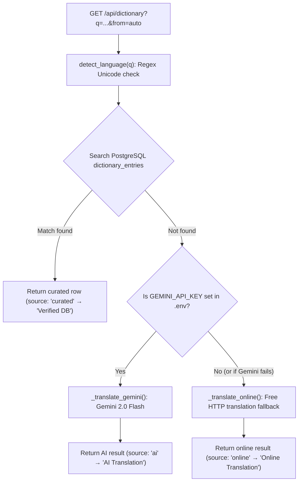

# LearnSolo: 3-Way Dictionary Guide (`content/dictionary.json`, `backend/`, `frontend/`)

A complete guide to using, managing, and extending LearnSolo's built-in **3-way dictionary** (**English ↔ Burmese ↔ Japanese**), including how its content, backend, and frontend layers connect.

The project documentation is split into connected guides:

| Guide | What it covers |
|---|---|
| **[docs/content-guide.md](content-guide.md)** | Writing **Notes**, **Practice sets**, **Mock Questions**, and interactive **TRY IT demos** in `content/` |
| **[docs/backend-guide.md](backend-guide.md)** | The **Flask + PostgreSQL** server in `backend/`: models, migrations, services, JSON API (`/api/...`), accounts, and `pytest` |
| **[docs/frontend-guide.md](frontend-guide.md)** | The **React + Vite** app in `frontend/`: pages, components, hooks, CSS styles, MathJax, answer checking, and `localStorage` |
| **[docs/dictionary-guide.md](dictionary-guide.md)** *(this guide)* | Everything about the **3-way English/Burmese/Japanese dictionary**: content format, CLI commands, hybrid backend engine, React drawer UI, and deployment |
| **[docs/oracle-server.md](oracle-server.md)** | How the Oracle Cloud production server (`https://learnsolo.duckdns.org`) is set up and deployed |

---

## 1. Overview

The dictionary is a floating, resizable study companion available on every page of LearnSolo (Notes, Practice sets, Mock Questions—including EJU Mock Papers, JLPT Mock Tests, and University Mock Questions—and the Home page). It is designed for students studying **Mathematics**, **Physics**, **Grade 12 Myanmar**, and **Japanese exams (EJU / JLPT)** who need fast, accurate translations across **English**, **Burmese (မြန်မာ)**, and **Japanese (日本語)**.

| Feature | Description |
|---|---|
| **Floating Action Button (FAB)** | Pinned to the bottom-right corner of every page (`FloatingDictionary.jsx`, mounted globally in `frontend/src/App.jsx`). |
| **Interactive & Resizable** | Users can drag the top-left corner or top/left edges to resize width and height, or click the expand/restore button (`⤢` / `⤡`). Size is saved in `localStorage` (`learnsolo_dict_size`). |
| **Automatic Language Detection** | Detects whether the user types in English, Burmese Unicode, or Japanese (Kanji/Kana) instantaneously on both the client (`detectScript`) and the server (`detect_language`). |
| **Hybrid Lookup** | Queries the local curated PostgreSQL database (`dictionary_entries`) first for instant, verified results (`source: "curated"`). Falls back to Gemini AI (`source: "ai"`) or online translation (`source: "online"`) if unlisted. |
| **Clean Database Policy** | Dynamic fallback lookups do **not** write unverified translations into PostgreSQL; only curated terms in `content/dictionary.json` or explicitly added via `flask add-word` are stored in the database. |

---

## 2. How Content, Backend, and Frontend Connect

Just like notes and practice sets, the 3-way dictionary spans all three layers of LearnSolo:

```
┌─────────────────────────── 1. CONTENT (content/) ───────────────────────────┐
│  content/dictionary.json                                                     │
│    Master JSON list of curated English / Burmese / Japanese study terms      │
└──────────────────────────────────────┬──────────────────────────────────────┘
                                       │
                            flask import-dictionary
                            (or flask add-word CLI)
                                       │
                                       ▼
┌─────────────────────────── 2. BACKEND (backend/) ───────────────────────────┐
│  • app.py registers `flask import-dictionary`, `list-dictionary`, `add-word` │
│  • models.py defines `DictionaryEntry` (`dictionary_entries` table in DB)   │
│  • api/dictionary.py exposes `GET /api/dictionary?q=<word>&from=<lang>`      │
│  • services/dictionary.py (`lookup_word`):                                   │
│      1. Auto-detects language (`en`, `my`, or `ja`)                          │
│      2. Searches `dictionary_entries` across English, Burmese, and Japanese │
│      3. If not in DB, falls back to Gemini 2.0 Flash or online translation   │
└──────────────────────────────────────┬──────────────────────────────────────┘
                                       │
                               JSON over HTTP (/api/dictionary)
                                       │
                                       ▼
┌────────────────────────── 3. FRONTEND (frontend/) ──────────────────────────┐
│  • App.jsx mounts <FloatingDictionary /> on every route                      │
│  • components/FloatingDictionary.jsx:                                        │
│      - Shows live auto-detect pill as the user types                         │
│      - Calls `fetch('/api/dictionary?q=...&from=...')` on submit             │
│      - Renders the 3-way result card with source badge ("Verified DB",       │
│        "AI Translation", or "Online Translation")                            │
│      - Saves custom drawer dimensions in `localStorage` (`learnsolo_dict_size`)│
│  • styles/dictionary.css styles the button, drawer, resize handles & fonts   │
└─────────────────────────────────────────────────────────────────────────────┘
```

### Where every dictionary file lives

```text
learnsolo/
├── content/
│   └── dictionary.json                        # Master curated vocabulary file
├── docs/
│   └── dictionary-guide.md                    # This guide
├── backend/
│   ├── app.py                                 # CLI commands: import-dictionary, list-dictionary, add-word
│   ├── models.py                              # DictionaryEntry SQLAlchemy model (dictionary_entries table)
│   ├── migrations/versions/                   # Alembic migration creating dictionary_entries
│   ├── api/__init__.py                        # Registers api/dictionary.py on api_bp (/api)
│   ├── api/dictionary.py                      # GET /api/dictionary endpoint
│   ├── services/dictionary.py                 # detect_language(), lookup_word(), _translate_gemini(), _translate_online()
│   └── tests/test_dictionary.py               # Automated pytest tests for detection, DB lookup, API, and CLI
└── frontend/
    └── src/
        ├── App.jsx                            # Mounts <FloatingDictionary /> globally
        ├── styles.js                          # Imports styles/dictionary.css
        ├── components/FloatingDictionary.jsx  # Floating button, resizable drawer, search & result card
        └── styles/dictionary.css              # FAB, drawer, resize handles, and Burmese Unicode font rules
```

---

## 3. Managing Curated Dictionary Content (`content/dictionary.json`)

LearnSolo follows a file-first philosophy: **curated vocabulary lives in `content/dictionary.json`**, and `flask import-dictionary` syncs it into PostgreSQL.

### Method 1: Editing `content/dictionary.json` (Recommended)

Open [content/dictionary.json](file:///home/music195/Projects/learnsolo/content/dictionary.json) in your editor. Each entry is a JSON object in the top-level array:

```json
{
  "word": "momentum",
  "english": "Momentum",
  "burmese": "အဟုန်",
  "japanese": "運動量",
  "reading": "うんどうりょう",
  "notes": "Physics: Product of mass and velocity (p = mv)"
}
```

#### Field specifications

| Field | Required? | Description | Example |
|---|---|---|---|
| `word` | **Yes** | Lowercase lookup key (`unique` in PostgreSQL) | `"momentum"` |
| `english` | **Yes** | Display title / definition in English | `"Momentum"` |
| `burmese` | **Yes** | Burmese translation in standard Myanmar Unicode | `"အဟုန်"` |
| `japanese` | **Yes** | Japanese Kanji or Katakana term | `"運動量"` |
| `reading` | Optional | Japanese reading in Hiragana or Furigana | `"うんどうりょう"` |
| `notes` | Optional | Subject context, formula, or short study note | `"Physics: Product of mass and velocity (p = mv)"` |

#### Importing into PostgreSQL

After editing `content/dictionary.json`, run from `backend/`:

```bash
cd backend
../venv/bin/flask import-dictionary
```

- New words are inserted into `dictionary_entries` with `source="curated"`.
- Existing words (matched by lowercase `word`) have their `english`, `burmese`, `japanese`, `reading`, and `notes` updated.

---

### Method 2: Adding a single word from the terminal (`flask add-word`)

To quickly add or update one word in your local database from `backend/`:

```bash
cd backend
../venv/bin/flask add-word --word "wavelength" \
                           --en "Wavelength" \
                           --my "လှိုင်းအလျား" \
                           --ja "波長" \
                           --reading "はちょう" \
                           --notes "Physics: Distance between wave peaks"
```

*(Tip: Also add permanent words to `content/dictionary.json` so they are tracked in git and deployed to Render and the Oracle server.)*

---

### Method 3: Inspecting words in the database (`flask list-dictionary`)

To list all vocabulary currently stored in PostgreSQL:

```bash
cd backend
../venv/bin/flask list-dictionary
```

Output preview:
```text
--- Total dictionary entries in DB: 108 ---
• acceleration   | EN: Acceleration | MY: အရှိန် | JA: 加速度 (かそくど) — Physics: Rate of change of velocity [curated]
• centroid       | EN: Centroid     | MY: ဒြပ်ဆုံမှတ် | JA: 重心 (じゅうしん) — Geometry: Triangle medians (2:1 ratio) [curated]
• discriminant   | EN: Discriminant | MY: ခွဲခြားပြကိန်း | JA: 判別式 (はんべつしき) — Algebra: D = b² - 4ac [curated]
• momentum       | EN: Momentum     | MY: အဟုန် | JA: 運動量 (うんどうりょう) — Physics: p = mv [curated]
```

---

### Method 4: Querying PostgreSQL directly (`psql`)

```bash
docker compose exec db psql -U learnsolo learnsolo
```

```sql
-- Count entries
SELECT count(*) FROM dictionary_entries;

-- Look up a specific word
SELECT word, english, burmese, japanese, reading FROM dictionary_entries WHERE word = 'momentum';

-- Quit psql
\q
```

---

## 4. Backend Engine & JSON API (`backend/`)

### How `lookup_word()` works (`backend/services/dictionary.py`)



1. **Automatic Script Detection (`detect_language`)**:
   - **Burmese (`"my"`)**: Myanmar Unicode blocks `\u1000-\u109F`, `\uAA60-\uAA7F`, `\uA9E0-\uA9FF`.
   - **Japanese (`"ja"`)**: Hiragana `\u3040-\u309F`, Katakana `\u30A0-\u30FF`, CJK Kanji `\u4E00-\u9FAF`, `\u3400-\u4DBF`.
   - **English (`"en"`)**: Latin letters `[a-zA-Z]`.
2. **Curated Database Search**:
   - Searches `DictionaryEntry` where `word == normalized`, `english ILIKE query`, `burmese ILIKE %query%`, or `japanese ILIKE %query%`.
3. **Dynamic Fallback**:
   - If `GEMINI_API_KEY` is configured in `.env`, `_translate_gemini()` requests a structured JSON definition and reading from `gemini-2.0-flash`.
   - Otherwise (or if the API call fails), `_translate_online()` translates the query into the other two languages using `requests`.

### API Endpoint (`backend/api/dictionary.py`)

- **Request:** `GET /api/dictionary?q=<word>&from=auto` (where `from` is optional: `auto`, `en`, `my`, or `ja`; returns `400` if `q` is empty).
- **Response (`200 OK`):**
  ```json
  {
    "query": "momentum",
    "detected_lang": "en",
    "english": "Momentum",
    "burmese": "အဟုန်",
    "japanese": "運動量",
    "reading": "うんどうりょう",
    "notes": "Physics: Product of mass and velocity (p = mv)",
    "source": "curated"
  }
  ```

---

## 5. Frontend Component & Styles (`frontend/`)

- **Component (`frontend/src/components/FloatingDictionary.jsx`):**
  - Mounted once in `frontend/src/App.jsx` outside `<Routes>`, so the dictionary stays open and keeps your current lookup even as you navigate between notes, practice sets, and mock papers.
  - Runs `detectScript(query)` on every keystroke to show immediate feedback in the **Auto-Detect** pill (`English (EN)`, `Burmese (မြန်မာ)`, or `Japanese (日本語)`).
  - Supports mouse and touch resizing from the top-left corner (`dict-resize-corner`), top edge (`dict-resize-top`), and left edge (`dict-resize-left`), clamped between `320×360` and viewport bounds, and persists `{width, height}` to `localStorage` under `learnsolo_dict_size`.
- **Styles (`frontend/src/styles/dictionary.css`):**
  - Imported globally in `frontend/src/styles.js`.
  - Uses `.myanmar-text` (`Pyidaungsu`, `Noto Sans Myanmar`, `Padauk`, sans-serif) for clean Burmese script rendering.

---

## 6. Deploying & Server Setup

Because curated dictionary entries live in `content/dictionary.json`, the database needs `flask db upgrade` (to create the `dictionary_entries` table) and `flask import-dictionary` (to load the words from `content/dictionary.json`).

### On your Oracle Cloud server (`https://learnsolo.duckdns.org`)

In `/etc/systemd/system/learnsolo.service`, `ExecStartPre` runs the database migrations, content import, and dictionary import automatically every time the service starts or restarts:

```ini
ExecStartPre=/home/ubuntu/learnsolo/.venv/bin/flask db upgrade
ExecStartPre=/home/ubuntu/learnsolo/.venv/bin/flask import-content
ExecStartPre=/home/ubuntu/learnsolo/.venv/bin/flask import-dictionary
```

*(Remember: if you ever edit `/etc/systemd/system/learnsolo.service`, run `sudo systemctl daemon-reload` before `sudo systemctl restart learnsolo`. Also ensure `requests` is installed in `.venv` via `~/learnsolo/.venv/bin/pip install requests`.)*

---

## 7. Running Dictionary Tests

From `backend/`:

```bash
cd backend
../venv/bin/pytest tests/test_dictionary.py -v
```

`tests/test_dictionary.py` verifies:
- `detect_language()` for English, Burmese, Japanese Kanji/Kana, and empty strings,
- `flask import-dictionary` and `flask add-word` CLI commands,
- `GET /api/dictionary` lookups in English, Burmese, and Japanese against curated entries,
- `400` handling when `q` is missing.
